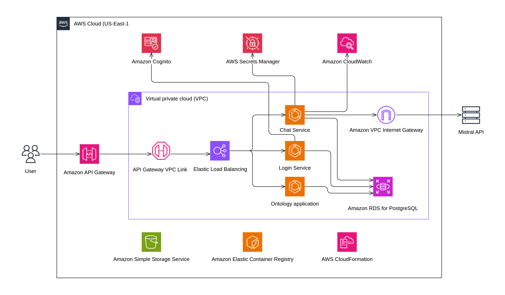

# Puroseka context ontology demo

A small implementation based on [AWS Context Ontology Accelerator (COA) v0.3.7](https://github.com/aws/context-ontology-accelerator/tree/v0.3.7): a fixed ontology helps a language model query historical event rankings and game metadata using PostgreSQL.

## Notice

> [!IMPORTANT]
>This is an independent demonstration, **not affiliated with or endorsed by Project SEKAI or its rights holders**. Data is obtained from **[sekai.best datasets (Sekai Viewer)](https://sekai.best/)**. Source data and generated artifacts are not distributed in this repository. Credits and licenses: [THIRD_PARTY.md](THIRD_PARTY.md), [upstream NOTICE](NOTICE), [LICENSE](LICENSE).

## Try the demo

Previously configured AWS endpoint: **[Puroseka chat](https://ad15hkc9md.execute-api.us-east-1.amazonaws.com/)** · [COA administration](https://ad15hkc9md.execute-api.us-east-1.amazonaws.com/admin/sources).

AWS availability depends on the Learner Lab session. The latest source changes await refreshed credentials and redeployment; see [the deployment checklist](TODO.md). Use `scripts/aws.py status` after deployment to confirm the endpoint.

The access migration provisions this public chat-only account:

| Email | Password | Initial shared allowance |
|---|---|---|
| `demo@02labs.me` | `demo1234` | 100,000 input/output tokens per six-hour window |

Credentials are intentionally public. All visitors share the allowance, including both responses in A/B mode. The reset time is shown in chat. Administrators can change the demo policy in **Manage → Token limits → Public demo**; existing policies and consumed tokens are preserved during setup.

Choose **Enhanced** for ontology context, **No enhancement** for the physical schema, or **A/B testing** to compare both using `ministral-8b-latest`. Try:

- Compare rank 100 progression in events 1 and 2 by elapsed event day.
- Show the daily score evolution at rank 100 in event 1.
- Which characters have cards associated with event 1?

## Data and context ontology

The imported dataset has **180 events**, 1,229 cards, 26 characters, 950 event-card associations, 815 gachas, and **1,117,619 ranking observations**. Ranking histories cover 142 events; the other 38 have no observations. All available observations are retained across 16 registered tables. There are 2,250 source/generated labels.


The diagram was regenerated from the supplied `puroseka-1.1.0` Turtle ontology: **16 classes, 15 object properties, 185 datatype properties and 850 RDF triples**.

| Element | Content |
|---|---|
| Catalog | Entity classes, table and column definitions, aliases, data types and coverage |
| Relationships | 15 associations connecting cards, characters, events, gachas and rankings |
| Rules | Meaning of timestamps, joins, ranking endpoints, daily changes and missing observations |
| RDF | Classes, datatype properties and object properties in `ontology.ttl` |
| Labels | Original names and approximate English convenience labels |
| NL2SQL examples | Six question/SQL pairs for comparisons, daily evolution, event cards and gacha pools |

Example column meanings:

| Column | Meaning |
|---|---|
| `events.start_at` | Competition start, Unix epoch milliseconds |
| `events.aggregate_at` | Competition aggregation boundary; `closed_at` is a later lifecycle boundary |
| `ranking_observations.observed_at` | PostgreSQL timestamp with time zone, already a timestamp |
| `ranking_observations.score` | Cumulative points observed at a rank; not a daily gain |
| `ranking_observations.row_key` | Source provenance and deterministic tie-breaker; this table has no `id` column |
| `event_cards.card_id` | Explicit card association; does not by itself prove pickup or bonus status |


Definitions are stored in [semantic/](semantic/). The catalog, RDF, labels and examples are prepared once in the ignored `artifacts/` directory and bundled into the application image. Source rows are imported into RDS PostgreSQL.

## Architecture

[](docs/Main.svg)

The diagram shows the target separation into chat, login and ontology applications. The current CloudFormation implementation packages these functions and the Cloudscape frontend into **one ECS application**. The three-service split is not implemented or deployed.

Browser requests pass through API Gateway, a VPC link and an internal Application Load Balancer to ECS. RDS PostgreSQL stores source data in `data` and accounts, sessions, token accounting and response jobs in `control`. The application uses independent query, login and chat database credentials; the operator credential is supplied only to import/migration tasks.

Cognito authenticates the private administrator; the public demo uses local Argon2id password verification. Secrets Manager holds runtime configuration, ECR stores the application image, S3 stores prepared artifacts, and CloudWatch receives logs. ECS uses a public IP and Internet Gateway for outbound Mistral requests. RDS has no public endpoint. CloudFormation manages the AWS resources in the Learner Lab VPC.

- `app/inference.py`: model calls, ontology context, asynchronous response generation and SQL evidence.
- `app/auth.py`, `app/auth_database.py`: Cognito/local sign-in, Argon2id hashes with login-time scrypt upgrades, opaque sessions and login throttling.
- `app/control.py`: token policies, accounting, response jobs and demo retention.
- `app/database.py`, `app/query.py`, `app/firewall.py`: source inspection and guarded read-only SQL.
- `semantic/`: ontology definitions, interpretation rules and NL2SQL examples.
- `web/`: React/Cloudscape chat and admin frontend, served by the ECS application.
- `infra/`, `scripts/`, `tests/`: CloudFormation templates, data preparation, operator tooling and verification.

## SQL firewall

Every model-generated query passes through the [SQL firewall](app/firewall.py) before execution. It accepts one SELECT using approved source tables, query constructs, built-in functions and built-in cast types. It rejects writes, schema changes, writable CTEs, SELECT INTO, row locks, stacked statements, private/system tables, schema-qualified functions, custom operators/types and unreviewed syntax. Rejected queries are not retried with weaker rules. Comments are removed and query length, AST size and nesting are bounded.

Queries execute through the SELECT-only database role inside read-only transactions, with a 15-second statement timeout, one-second lock timeout, 100-row limit and 24 KB evidence limit. Login and chat connections have separate table/column grants. Chat cannot read password hashes or sessions, and neither writable connection can access the source dataset.

## Setup and deployment

1. Install Python 3.15, Node 24, Docker and the AWS CLI, then install dependencies:

   ```bash
   python3.15 -m venv .venv
   .venv/bin/pip install -r requirements.txt
   npm --prefix web ci
   ```

2. Create `.env` from [.env.example](.env.example). Set `MISTRAL_API_KEY`, `MISTRAL_MODEL`, `CHAT_USERNAME` (email) and `CHAT_PASSWORD` (at least 12 characters, including uppercase, lowercase and numbers). For local PostgreSQL, also set the four database URLs; use port `54329` and the operator password from [compose.yml](compose.yml).

3. Update the AWS CLI credentials from Learner Lab and select `us-east-1`:

   ```bash
   aws configure set region us-east-1
   aws sts get-caller-identity
   ```

4. For a new dataset, prepare the local artifacts:

   ```bash
   .venv/bin/python scripts/prepare.py --source /path/to/raw_datasets/metadata
   .venv/bin/python scripts/enrich_once.py
   .venv/bin/python scripts/prepare_rankings.py --source /path/to/raw_datasets/event_rank_snapshots
   .venv/bin/python scripts/finalize_semantics.py
   ```

   For an existing AWS installation, keep the prepared `artifacts/` directory and skip preparation/import.

5. Start local PostgreSQL, set `LOCAL_TEST_DATABASE_URL` to its operator connection, then run checks and build the frontend:

   ```bash
   docker compose up -d db
   .venv/bin/python -m pytest -q
   npm --prefix web run build
   ```

6. Commit source changes, audit and push `main`:

   ```bash
   PRIVATE_REFERENCE_ENV=/path/to/private/reference.env .venv/bin/python scripts/audit_publication.py
   git push origin main
   ```

7. For a new installation, provision the foundation through CloudFormation:

   ```bash
   .venv/bin/python scripts/aws.py bootstrap
   .venv/bin/python scripts/aws.py wait
   ```

8. Deploy the application and configure access. For an existing installation, run:

   ```bash
   .venv/bin/python scripts/aws.py deploy --app-only --configure-access
   ```

   For a new installation, run `.venv/bin/python scripts/aws.py deploy --configure-access` instead. For an existing dataset, apply [infra/daily-index.sql](infra/daily-index.sql) through an operator connection outside a transaction if the index is not already installed.

9. Check status, open the reported HTTPS address for chat, and use `/admin/sources` for the administration dashboard:

   ```bash
   .venv/bin/python scripts/aws.py status
   ```

10. For later application updates, run `.venv/bin/python scripts/aws.py deploy --app-only`. Use `scripts/aws.py stop` and `scripts/aws.py resume` between lab sessions. To update the Mistral key/model from `.env`, run `scripts/aws.py refresh-secrets`, then `scripts/aws.py resume`.

See [user chat and authentication](docs/user-chat.md) and [Cloudscape integration](docs/cloudscape-ui.md) for additional implementation details.
