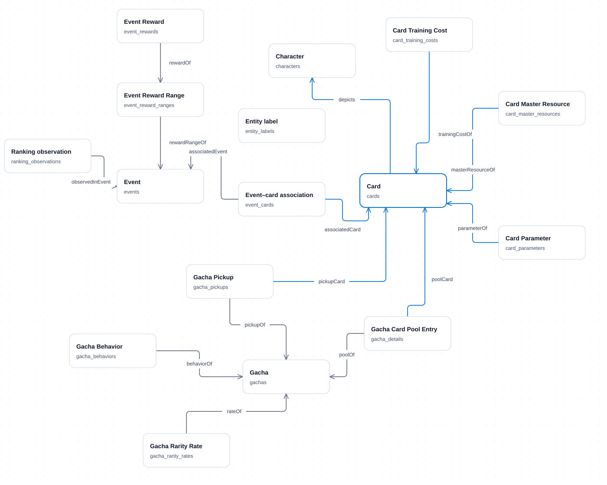

# Puroseka Semantic Context PoC

Public source repository: [02loveslollipop/coa-puroseka](https://github.com/02loveslollipop/coa-puroseka).

This repository contains application code, CloudFormation templates, hand-authored ontology definitions and SQL examples. It does not distribute source datasets, generated data/ontology exports, translations, execution traces, deployment state, credentials or local run reports. Supply your own local dataset and prepare the ignored `artifacts/` directory before importing, running integration tests or building the deployment image.

Chat endpoint: https://ad15hkc9md.execute-api.us-east-1.amazonaws.com · [COA administration](https://ad15hkc9md.execute-api.us-east-1.amazonaws.com/admin/sources). CloudFormation stacks manage the app, Cognito, and private HTTPS gateway. The HTTPS address persists when ECS replaces its task.

A small adaptation of [AWS Context Ontology Accelerator v0.3.7](https://github.com/aws/context-ontology-accelerator/tree/v0.3.7), using its React/Cloudscape application shell and Scan → Model → Serve organization. It is an independent PoC backend, not a deployment of the full upstream platform.

The demonstration compares the same Mistral model and PostgreSQL query tool with **physical schema only** and with an additional **fixed ontology, semantic catalog, and domain NL2SQL examples**. It does not assume the enriched agent always wins. Inspect the generated query and returned rows rather than treating model wording as verified evidence.

## What the prepared PoC supports

- All five supplied metadata files, including their complete original JSON records: 180 events, 1,229 cards, 26 characters, 950 event–card associations, and 815 gachas.
- Fifteen normalized source tables: the five primary tables plus card parameters/costs/master resources, event reward ranges/rewards, and gacha pool entries/pickups/behaviors/rarity rates. The full historical ranking stream is normalized into `ranking_observations`. A separate `entity_labels` table holds approximate translated titles and source English character names.
- Fifteen validated source relationship paths, SQL mappings, definitions, interpretation rules, and downloadable RDF/Turtle ontology.
- Read-only source inspection, an interactive ontology graph, and an inference playground with separate Base/Enriched histories, comparison, SQL evidence, context, and request traces.
- A dedicated end-user chat UI with sidebar agent selection, A/B comparison, and administrator Review mode for tool/model input-output JSON; separate COA administration pages; and one predefined Cognito account shared between both. Token usage is metered persistently, with enforcement **off for the test**. The COA Token limits page can configure and enable it later.
- ECS Fargate, single-AZ RDS PostgreSQL, S3, ECR, Secrets Manager and CloudWatch in the existing Learner Lab VPC, plus an HTTPS API Gateway endpoint reaching ECS through a VPC link and internal application load balancer. No NAT gateway, Bedrock or Neptune.

All 3,894 ranking snapshot files across 180 event directories are processed: 1,117,619 valid observations for 142 events. The other 38 event directories have no valid ranking observations: 35 contain empty/null-only histories and three contain no JSON files. The source contains 1,542 null entries and 4,516 duplicate timestamps within series; duplicates are retained with deterministic provenance tie-breaking. no event/rank sampling is applied. Ranking data is streamed into the database, with full original observation records preserved. Null array entries are counted in the ranking manifest and are not treated as observations. Missing source entities such as resource-box and skill definitions remain opaque references. An event association does not imply a positive card bonus; a gacha pool entry does not imply a pickup; a banner/event time overlap does not imply a domain relationship.

## Local setup

Requires Python 3.12+, Node 22+, Docker, and AWS CLI credentials for deployment.

```bash
python3 -m venv .venv
.venv/bin/pip install -r requirements.txt
cp .env.example .env
# Set MISTRAL_API_KEY and an available MISTRAL_MODEL in .env.
# Set CHAT_USERNAME (email), CHAT_PASSWORD, and the four database URLs.
# For Docker PostgreSQL, use port 54329 and its configured operator password.
.venv/bin/python scripts/prepare.py
.venv/bin/python scripts/enrich_once.py
.venv/bin/python scripts/prepare_rankings.py
.venv/bin/python scripts/finalize_semantics.py
npm --prefix web ci
npm --prefix web run build
docker compose up -d db
.venv/bin/python -m scripts.import_data
.venv/bin/python -m scripts.setup_access
.venv/bin/uvicorn app.main:app --host 127.0.0.1 --port 8000
```

Open http://127.0.0.1:8000 and sign in with the credentials saved in `.env`. Local development uses the single-account password-hash fallback; the deployed service uses Cognito. The same account opens `/` for chat and `/admin/sources` for the COA. For frontend development, use `npm --prefix web run dev`; set `PUBLIC_ORIGIN=http://127.0.0.1:5173` for the backend so origin validation matches Vite.

Preparation defaults to `/home/zerotwo/Documents/puroseka/puroseka/raw_datasets/metadata`; override with `scripts/prepare.py --source PATH`. Run `finalize_semantics.py` after both translations and ranking preparation finish. It publishes semantic version 1.1.0 and the curated SQL examples. Do not rerun preparation during translation. It rebuilds the catalog; rerun enrichment afterward to restore its label-table metadata. Translation batches are cached in `artifacts/translations.json` and resume after interruption. This is an operator-only build step; the deployed image includes only the importer, with no enrichment scripts or enrichment API.

The original configured `mistral-medium-latest` and `mistral-small-latest` returned HTTP 429 with a request limit of zero during implementation. `ministral-8b-latest` completed requests with the same key, so it is the active model. Account allowances can change; `scripts/enrich_once.py --check-only` verifies a completion. This script uses `MISTRAL_MODEL`, not an automatic paid-model fallback.

## Deploy to Learner Lab

1. Update the AWS CLI credentials from Learner Lab and select `us-east-1`.

2. Set `MISTRAL_API_KEY`, `MISTRAL_MODEL`, `CHAT_USERNAME` and `CHAT_PASSWORD` in `.env`.

3. For a new installation, prepare the dataset using the local setup commands, then provision the foundation:

   ```bash
   .venv/bin/python scripts/aws.py bootstrap
   .venv/bin/python scripts/aws.py wait
   ```

4. Build and deploy through CloudFormation. For an existing installation, run:

   ```bash
   .venv/bin/python scripts/aws.py deploy --app-only --configure-access
   ```

   For a new installation, run `.venv/bin/python scripts/aws.py deploy --configure-access` instead.

5. Check status and open the HTTPS address printed by:

   ```bash
   .venv/bin/python scripts/aws.py status
   ```

6. For later application updates, run `.venv/bin/python scripts/aws.py deploy --app-only`.

7. To change diagnostic access after an IP change, run:

   ```bash
   .venv/bin/python scripts/aws.py bootstrap --browser-cidr YOUR.PUBLIC.IP.ADDRESS/32
   .venv/bin/python scripts/aws.py wait
   ```

## Across lab sessions

```bash
.venv/bin/python scripts/aws.py stop
.venv/bin/python scripts/aws.py resume
.venv/bin/python scripts/aws.py status
```

Data, semantic artifacts, sessions, token accounting and policy persist in RDS/S3/Secrets Manager. The ECS service starts a fresh task after a resume; its diagnostic public IP may change, while the HTTPS endpoint stays the same. User chat histories are stored per account in this browser; “New chat” opens a new conversation. Select a conversation in the sidebar and choose **Delete chat** to remove its local history after confirmation. Deleting the last chat opens a fresh conversation. This does not erase server execution records or token accounting. COA playground histories stay separate by mode. Chats include up to three previous successful turns; comparisons start with no history in either mode.

Learner Lab session credentials expire. Refresh the AWS CLI credentials from the lab before running deployment/lifecycle commands again. Lab shutdown rules may affect service availability; this project does not assume Fargate bypasses those rules.

`stop` scales ECS to zero and requests an RDS stop. The HTTPS load balancer, storage and secrets still incur charges; RDS automatically restarts after seven days. To update the Mistral key/model after changing `.env`, run `refresh-secrets`, then `resume` to replace the running task and load the updated configuration.

For final cleanup, `teardown` detaches the ECS target group, deletes the HTTPS and Cognito stacks, empties the artifact bucket, and requests deletion of the application stack including the database. This intentionally deletes PoC data and the predefined account; retained source datasets on this computer are unaffected.

## Expected costs

The small Fargate task, RDS instance, storage, public IPv4 and secrets remain billable according to their usage. The authenticated HTTPS setup adds an internal application load balancer and API Gateway requests. The load balancer remains billable while ECS is stopped. Sources: [Fargate pricing](https://aws.amazon.com/fargate/pricing/), [RDS pricing](https://aws.amazon.com/rds/postgresql/pricing/), [Elastic Load Balancing pricing](https://aws.amazon.com/elasticloadbalancing/pricing/), [API Gateway pricing](https://aws.amazon.com/api-gateway/pricing/). Mistral account-specific quotas apply independently of the COA token policy.

## Verification

```bash
.venv/bin/python -m pytest -q
npm --prefix web run build
```

Set `LOCAL_TEST_DATABASE_URL` to a disposable local PostgreSQL operator connection to run database-role and AWS parity tests. These create and remove temporary databases. Legacy imported-dataset tests additionally require `TEST_DATABASE=1` and a configured local dataset.

In the playground, compare:

1. Which characters have cards associated with event 1?
2. How many distinct cards are listed in each of the first five gachas?
3. When did event 1 finish its competition period, in UTC?
4. Compare rank 100 progression in events 1 and 2 by elapsed event day.
5. Show the daily score evolution at rank 100 in event 1.
6. What is the current score needed to reach rank 100? (Unsupported: the supplied histories are not live data.)

Source-grounded answers for questions 1 and 3 are character IDs **1, 2, 3, 4, 24**, and **2020-10-18 11:59:59 UTC**, respectively. These provide comparison checks without asserting that every model run will be correct.

## Interfaces and safeguards

`GET /api/health` is the public health probe. Catalog, schema, manifest, source tables, translations, ontology and detailed inference require an administrator session. `POST /api/inference` accepts `{question, mode: "base" | "enriched", history: [{role, content}]}` and returns context, query, bounded evidence and response details for the COA. Both UIs submit asynchronous inference jobs and poll their result, avoiding API Gateway's request timeout. `/api/chat/jobs` accepts `mode: "base" | "enriched"` (default enriched) and returns a user response and timing/usage metrics without SQL or prompt traces. The user chat's A/B mode submits the same question to both variants with empty histories. FastAPI's `/docs` exposes the typed API contract; its protected operations still require authentication and CSRF headers.

Each answer has a separate **Tool activity** timeline before its bubble, with live execution status. In the chat sidebar, **Review mode** adds recorded input/output JSON to that timeline and executed SQL/results inside the answer bubble, using `GET /api/jobs/{id}/review`. This endpoint checks ownership and administrator access; ordinary responses expose only safe step summaries. Opening a review does not invoke the model again. See [user chat and review details](docs/user-chat.md).

The ECS application uses three independent PostgreSQL logins, stored server-side in Secrets Manager:

| Connection | Access |
| --- | --- |
| `DATABASE_URL` / `puroseka_reader` | SELECT on the 16 approved tables in `data` |
| `LOGIN_DATABASE_URL` / `puroseka_login` | Authentication columns, password-hash updates, sessions and login attempts |
| `CHAT_DATABASE_URL` / `puroseka_chat` | Policy columns, token budgets, reservations and response jobs |

The database operator credential is supplied only to migration/import tasks. Runtime roles cannot create schema objects, manage roles, change account roles/enablement, or switch to each other. The query role defaults to read-only transactions. Application-only updates require the separate credentials; rerunning access setup preserves passwords for the database roles and existing token consumption. AWS retains one ECS application; these credentials separate its database operations.

Only a single validated SELECT can reach the query connection. Imported-table and SQL-function allowlists, SELECT-only grants, read-only transactions, a fifteen-second statement timeout, and row/evidence-size limits constrain execution. Raw database errors and credentials are not sent to the model or browser. Model-generated language can still be wrong: SQL and evidence remain visible for assessment. Request traces contain supplied prompts and returned evidence, not hidden model reasoning.

The frontend shell and page patterns are adapted from AWS COA with modification notices. See `LICENSE`, `NOTICE`, and `THIRD_PARTY.md`.

## Ranking analysis conventions

`ranking_observations(event_id, rank, score, observed_at, user_id, leader_card_id, source_file, row_key, raw_record)` contains the complete available history. `observed_at` is already `timestamptz`; event metadata boundaries remain epoch milliseconds. Composite indexes support event/rank/time and rank/event/time queries.

The Data Sources page includes a selectable score-over-time chart. The enriched context explicitly reports which metadata events lack valid ranking observations. The enriched model receives five validated question/SQL examples in `semantic/few_shots.json`, including comparisons of last observed scores, daily changes with missing-day gaps, and progression aligned by elapsed event day. The before/after comparison therefore measures ontology plus examples against schema-only context, not ontology in isolation.

Calendar-day evolution defaults to UTC and selects each day's latest observed score. Changes refer to consecutive observed endpoints, with a day-gap column; missing days are not zero. Event-to-event progression uses elapsed 24-hour days since each event started. Competition analyses filter between `start_at` and `aggregate_at`, and last-observed values are never presented as guaranteed official final scores.

Run `.venv/bin/python scripts/evaluate.py` with `DATABASE_URL` set to record actual Base/Enriched outputs beside independently executed reference queries. Results are saved to `artifacts/evaluation.json`; inspect them rather than assuming model-generated SQL is semantically correct.

## Cloudscape UI

The UI uses the official Cloudscape React components and patterns directly. The components repository was pulled and inspected at commit `43480f9`. Native components now handle page layout, collection filtering/sorting/pagination, ranking charts, prompt input, chat messages, code views and copy actions. See [Cloudscape integration](docs/cloudscape-ui.md) for source provenance and package details.

Use `.venv/bin/python scripts/aws.py deploy --app-only` for UI updates that preserve the imported data and current model configuration.


## Current application parity

This AWS version retains the existing CloudFormation, ECS/RDS deployment and optional Cognito authentication. It now includes the same Cloudscape login layout, draggable ontology explorer, bottom sidebar attribution, demo token-policy selector, 24-hour demo response retention, local token counting, six NL2SQL examples, bounded SQL repair and SQL firewall as the Heroku demonstration. SQL generation uses a bounded JSON schema and a 4,096-token output cap; answer synthesis retains 1,800 tokens. Account usage is preserved independently of these per-response caps.



The diagram was regenerated from the supplied Turtle schema and screenshot: 16 classes, 15 object properties, 185 datatype properties and 850 schema triples. No source records are included in the public diagram.

The public chat-only demo uses `demo@02labs.me` / `demo1234`. Its initial AWS allowance is 100,000 tokens per six-hour window, configurable in **Manage → Token limits → Public demo**. Demo authentication uses the local password hash even when the private administrator uses Cognito. Existing accounts, policies, consumed tokens and active reservations are preserved by setup. Demo responses expire after 24 hours; raw prompts, history and full Review traces are excluded. Cleanup runs on startup and every ten minutes while the application runs.

The SQL firewall rejects writes, writable CTEs, private/system tables, row locks, custom functions/operators/types and unreviewed syntax before execution. Dataset connections start read-only with a `pg_catalog` search path; physical tables are explicitly qualified in `data`. Authentication uses `LOGIN_DATABASE_URL`; chat state and token accounting use `CHAT_DATABASE_URL`. Neither can access the dataset, and chat cannot read password hashes or sessions. The 15-second execution, one-second lock, 100-row and 24 KB evidence limits remain in place.

For an existing AWS installation, run the access setup with the local operator credential to seed the demo without changing existing policies. Apply [infra/daily-index.sql](infra/daily-index.sql) separately using an operator connection outside a transaction; it adds the covering UTC-day index without changing source rows. Then use the existing CloudFormation application-only deployment. `DemoTokenLimit` and `DemoWindowSeconds` provide initial task configuration; dashboard policy changes take precedence for existing accounts.


Local passwords now use Argon2id (`argon2-cffi`, 64 MiB, three passes, one lane), with random salts and at most two concurrent hash operations. Existing scrypt passwords and outdated Argon2id parameters upgrade after a successful local login; failed or disabled logins do not rewrite hashes. Password changes are rechecked before a session is issued. Cognito-managed administrator passwords remain managed by Cognito. The next AWS access migration provisions independent query, login and chat PostgreSQL credentials, replaces direct table/column grants, and removes the old shared control role’s application-schema access. Existing accounts, sessions, policies and usage remain in place. AWS redeployment awaits refreshed Learner Lab credentials.
