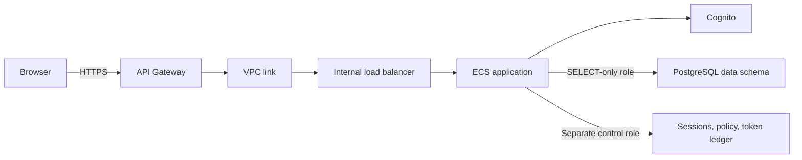

# User chat, Cognito, and token metering

The default `/` route is a dedicated user chat, following the [Cloudscape generative AI chat](https://cloudscape.design/gen-ai/patterns/generative-ai-chat/), [support prompts](https://cloudscape.design/gen-ai/patterns/support-prompts/), [loading states](https://cloudscape.design/gen-ai/patterns/generative-ai-loading-states/), and [conversation history](https://cloudscape.design/gen-ai/patterns/conversational-history/) patterns. It uses native `PromptInput`, `ChatBubble`, `Avatar`, `SupportPromptGroup`, `CopyToClipboard`, and `LiveRegion`. The composer stays visible while the conversation log scrolls. Copy and regeneration actions remain visible. Loading text describes the operation without inventing intermediate reasoning.

COA source inspection, ontology, comparison and token-policy settings live under `/admin`. The shared predefined account is an administrator and can access both experiences. A future account with the `user` role can use chat but is denied administrative API routes. The backend enforces this distinction independently of navigation.

Both the chat and administration headers include an external **GitHub repository** link to the public application source. The repository contains no datasets or generated artifacts; prepare those locally from your own source files.

## Removing a conversation

Select a conversation under Recent chats and choose **Delete chat** in the sidebar. The confirmation names the selected conversation; Cancel preserves it. Confirming removes its text and A/B responses from this browser's account-specific history, then opens another saved chat. Deleting the last chat opens a fresh conversation with the same agent mode. Deletion is disabled while a response is running. It does not delete server-side job/review records, reset usage, or change the token policy.

## Response variants and A/B testing

The chat sidebar contains a **Response agent** selector: **No enhancement** supplies the physical database schema, while **Enhanced** adds the fixed ontology, semantic rules and NL2SQL examples. The sidebar also contains the **A/B testing** toggle. Both variants use the same `ministral-8b-latest` model, query safety checks and data. Changing the selection opens a separate conversation so enhanced responses do not enter the other variant's chat history. Existing saved chats remain available.

Enable **A/B testing** to submit the same question to both variants with empty histories. Responses appear side by side on desktop and stack on smaller screens. Each response shows its observed time and provider-reported token count, with independent copy actions. Comparisons run sequentially to avoid competing for the same model-request lock; they do not claim a statistically controlled performance benchmark or a guaranteed winner. Regeneration repeats both variants and meters both again. If one variant fails, its error remains visible and the other still runs.

## Review mode

Each answer has a separate **Tool activity** section immediately before its answer bubble. It uses Cloudscape's [progressive steps](https://cloudscape.design/gen-ai/patterns/progressive-steps/) pattern: execution steps update while the request runs, and the completed timeline is collapsed by default. Schema reads, SQL generation, database queries and response writing show their actual status and duration. These are recorded workflow operations, not generated private reasoning.

Enable **Review mode** in the sidebar to inspect recorded execution JSON. For the shared administrator account, expand Tool activity to inspect:

- **Tool calls**: the actual schema-introspection and SQL-query arguments/results, execution status, and duration.
- **Model calls**: the query-generation and response-synthesis request payloads, visible returned content, token usage, status, and duration.
- **Input JSON** and **Output JSON**: the effective inference input and bounded workflow result, with native code-view copy controls.

In Review mode, **Executed SQL** and **SQL results** appear inside the answer bubble. SQL comes from the successful database tool result, including normalization by the query guard. Results show the bounded returned rows, a JSON view, and any truncation notice. A rejected SQL attempt remains visible in its failed tool call and is not labeled as executed evidence.

In A/B mode, each variant has its own timeline above its own answer bubble. Review details are fetched once per displayed response when Review mode is enabled, using `GET /api/jobs/{id}/review`; expanding the call JSON and SQL results uses that recorded response. Reading a review does not rerun inference or consume model tokens. New jobs record their calls even when the switch is off, so review can be enabled afterward. Older jobs without recorded data can be regenerated explicitly.

Review is restricted to an administrator viewing their own job. The ordinary chat endpoint exposes only step names, kinds, statuses and durations as progress metadata; it omits the private review payload for all roles, and a user-role account cannot fetch that payload. Traces remain in PostgreSQL, while browser history stores response text, metrics, job IDs and safe progress summaries. Model traces are constructed from request JSON and visible output content; authorization headers, API keys, Cognito credentials, cookies, and hidden reasoning fields are not captured. Errors from database connections are normalized to avoid exposing connection details.

## Sign-in

The account comes from `CHAT_USERNAME` and `CHAT_PASSWORD` in `.env`; `ADMIN_USERNAME`/`ADMIN_PASSWORD` take precedence if supplied. The username is normalized to lowercase. Credentials are never put in frontend bundles, CloudFormation parameters, logs or responses. Cognito has self-registration disabled, and account provisioning suppresses email messages. The server keeps the Cognito app-client secret in Secrets Manager.

The backend exchanges credentials with Cognito, confirms the returned identity, and issues a random opaque browser session. Only the session's SHA-256 digest is stored in PostgreSQL. Sessions expire after one hour, can be revoked by signing out, and use `Secure`, `HttpOnly`, `SameSite=Strict` cookies over the deployed HTTPS endpoint. State-changing requests require the expected `Origin` and a session CSRF token. Login attempts are throttled persistently.

Local development has a fixed-account fallback using salted scrypt password hashes. A deployed Cognito outage does **not** trigger a fallback to password authentication. Cognito was available and is the deployed provider.



The HTTP leg after API Gateway stays inside the VPC. The load balancer accepts only the VPC-link security group; ECS accepts it through a separate security-group rule. The original `/32` diagnostic access is retained. CloudFront and Cloud Map creation were restricted by this Learner Lab, so the deployed gateway uses the internal load balancer.

## Token policy

**Enforcement is off for the test, as requested.** Metering stays active. The parked initial policy values are 100,000 tokens and a 3,600-second window; they impose no limit while disabled. Open **COA administration → Manage → Token limits** to set the desired allowance and enable enforcement later. The account is shared, so COA playground calls and user-chat calls count toward the same usage.

Every query-generation and response-synthesis call makes an atomic PostgreSQL reservation before contacting Mistral. Input reservation uses a conservative UTF-8 byte bound plus template overhead and the configured output cap; it is an estimate, not an exact model tokenizer. After a successful response the provider-reported total replaces the reservation. An enabled policy can therefore refuse a call before the displayed remaining allowance reaches zero if there is insufficient headroom for its conservative reservation.

Explicit rejected provider requests are not charged. Unknown usage, timeouts and interrupted requests retain a conservative charge. An active reservation left by a terminated process is settled conservatively after ten minutes. Concurrent reservations cannot spend the same allowance. Sessions, reservations, actual usage and the enable switch survive ECS task replacement. Policy changes preserve current consumption; a duration change applies at the next reset. Mistral's own sandbox quota remains independent and applies even when the COA limit is off.

## Deployment

```bash
.venv/bin/python scripts/aws.py deploy --app-only --configure-access
```

This provisions `infra/auth.yaml` and `infra/gateway.yaml`, updates `infra/stack.yaml`, and runs `scripts.setup_access` once in a transient ECS task using the administrative credential. It preserves all source data and the selected model. The migration seeds a new account with limits disabled and preserves an existing policy on subsequent runs. Temporary provisioning credentials are removed from the current administrative secret version after migration; Cognito runtime does not need the user's password.

Application updates retain the previous healthy ECS task until its replacement is healthy. A deployment can temporarily run two small tasks, while the steady-state service runs one. Shared database sessions, job results and token accounting work across both tasks.

Both interfaces submit background jobs and poll their completion. Job ownership is checked on every read; ordinary chat responses omit generated SQL, schema context and request traces. Administrator Review mode retrieves those details through its separate protected endpoint. Browser histories are local to the current browser/account; they are not a promise of cross-device history. An interrupted job is reported as expired rather than replayed automatically and potentially charging twice.
